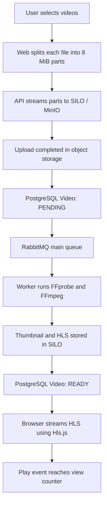
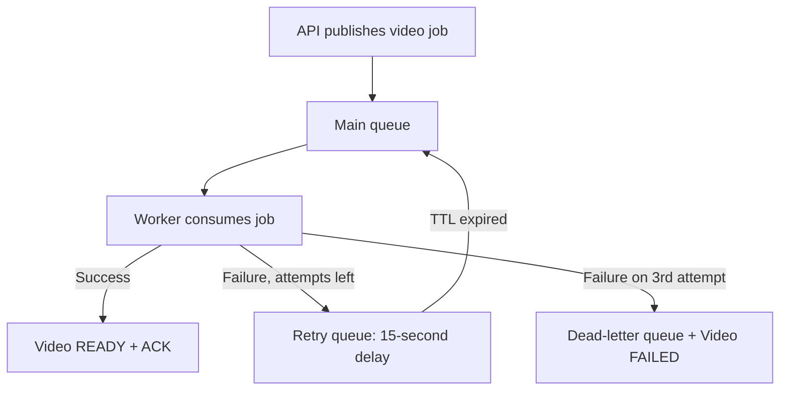
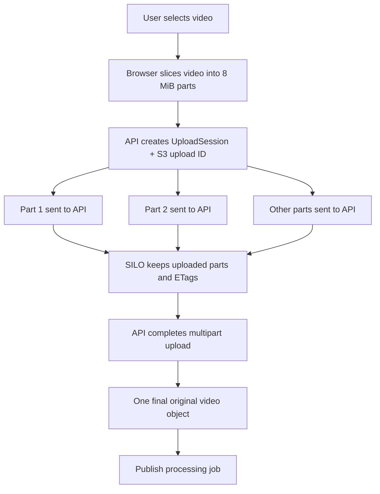
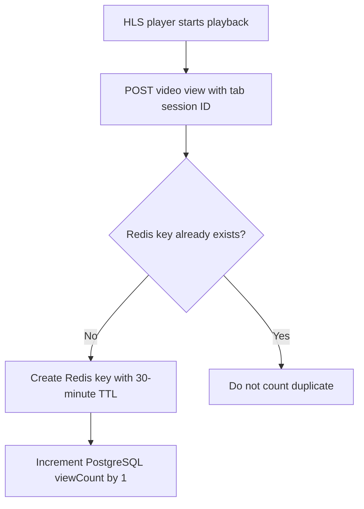

# Video Media Pipeline — Easy Explanation

This is the **start-here** guide for understanding uploads, queues and counting.

## 1. Full video flow



**Remember:** the API receives uploads; the **worker** does CPU-heavy processing; **PostgreSQL** stores permanent records; **Redis** stores temporary progress and deduplication keys; **SILO** stores the actual media files.

## 2. RabbitMQ — why three queues?

| Queue                          | Purpose                                                   |
| ------------------------------ | --------------------------------------------------------- |
| `video_processing_queue`       | Normal jobs waiting for a worker                          |
| `video_processing_queue.retry` | Failed jobs waiting **15 seconds** before another attempt |
| `video_processing_queue.dlq`   | Jobs that fail permanently or have invalid payloads       |



Example: **attempt 1 → 15 seconds → attempt 2 → 15 seconds → attempt 3 → DLQ** if each attempt fails. There are **3 total processing attempts**, not 3 extra retries. The worker waits for publishing confirmation before acknowledging failed messages.

Read: [Queue Processing](architecture/queue-processing.md).

## 3. Multipart upload — why parts?

Large uploads do **not** need to restart from zero after a network interruption.



- Browser uploads **one part at a time** in the current implementation.
- Each part goes through the authenticated API and is streamed to private object storage.
- An interrupted part can be retried (up to **3 attempts per part**).
- **Pause** stops sending more parts; already uploaded parts remain available.
- **Resume after refresh:** reselect the _same file_. The browser recovers the saved session ID and the API lists uploaded parts, so only missing parts are sent.
- Upload sessions expire after **24 hours**. Maximum accepted file size is **2,147,483,647 bytes (just under 2 GiB)**.

Read: [Multipart Upload](architecture/multipart-upload.md).

## 4. View count — why Redis?

A video **play event** triggers counting; merely loading its thumbnail or HLS segments does not.



- The browser keeps the view session ID in **sessionStorage** (per tab session).
- Redis stores a temporary key for **video ID + tab session ID** for 30 minutes.
- The permanent `viewCount` lives in PostgreSQL.
- This is an **approximate play-event count**, not unique people or full video watches.

**Download count:** an authenticated owner/admin gets a **60-second, single-use ticket**. When the original download HTTP response finishes successfully, the API attempts to increment `downloadCount` in PostgreSQL.

Read: [Views, Downloads & Analytics](architecture/analytics.md).

## 5. Video statuses

| Status       | Meaning                                       |
| ------------ | --------------------------------------------- |
| `PENDING`    | Uploaded and queued / waiting to retry        |
| `PROCESSING` | A worker owns the current job                 |
| `READY`      | HLS and thumbnail processing completed        |
| `FAILED`     | All attempts exhausted (or permanent failure) |

## 6. Quick verification (PowerShell or terminal)

```bash
# Start services and check their status
docker compose up -d
docker compose ps -a

# API readiness should respond HTTP 200
docker compose exec api node -e "fetch('http://127.0.0.1:3000/api/v1/health').then(r=>console.log(r.status)).catch(console.error)"

# Confirm main, retry, and DLQ exist
docker compose exec rabbitmq rabbitmqctl list_queues name messages_ready messages_unacknowledged consumers

# See worker processing activity
docker compose logs --tail=100 worker
```

See [Manual Verification Checklist](verification/manual-checklist.md) for the full user flow.
