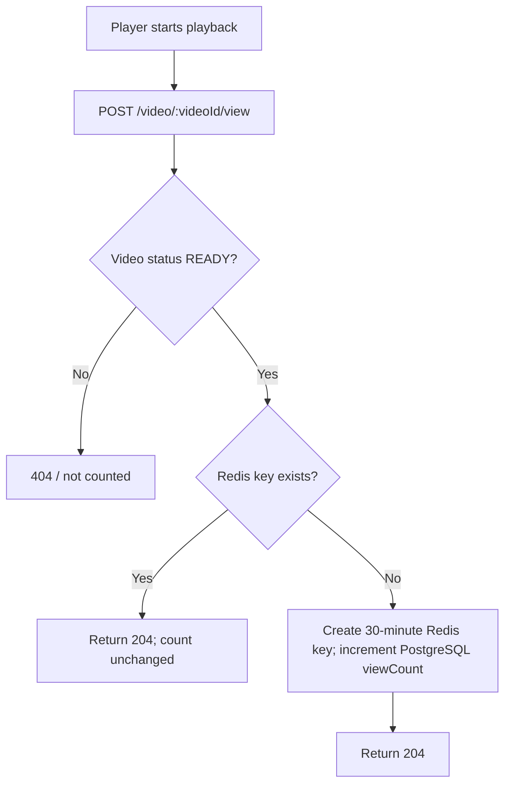
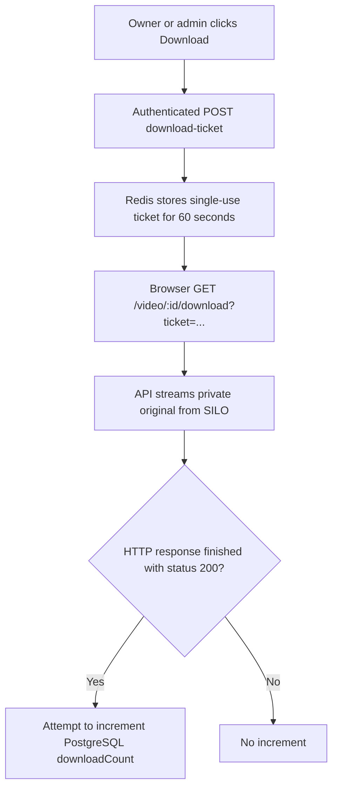

# Video Views, Downloads & Admin Analytics

## 1. When is a view counted?

**A play event counts as a view**. Opening a gallery, downloading a thumbnail, or fetching an HLS segment does not count.

- Browser creates a UUID in **sessionStorage** for the current tab session.
- Deduplication key: `video:view:{videoId}:{sessionId}` with a **30-minute** TTL.
- Database field: `Video.viewCount`.
- This is a **play-event estimate**, not a count of unique humans or completed views.

## 2. Original video download count

The ticket is **single-use**. The download count is incremented asynchronously after the HTTP response `finish` event; it may not update if that database write fails. Finishing a response is not proof the file was saved to the user's disk.

## 3. Admin dashboard metrics

| Metric                                | Source                                                          |
| ------------------------------------- | --------------------------------------------------------------- |
| Total videos                          | PostgreSQL video count                                          |
| Pending / Processing / Ready / Failed | PostgreSQL grouped by status                                    |
| Total views / downloads               | Sum of PostgreSQL counters                                      |
| Original file bytes                   | Sum of FFprobe-reported `fileSizeBytes`                         |
| Object storage usage                  | Total object sizes in SILO, cached in Redis for 60 seconds      |
| Average processing time               | PostgreSQL `processedAt - processingStartedAt` for READY videos |
| Main / retry / DLQ depth              | RabbitMQ queue message counts                                   |

Only a user with the **ADMIN** role can access admin metrics and the admin video listing.

## 4. Verify

1. Play a READY video: view count should increase once for the current tab session.
2. Replay within 30 minutes in the same tab: it should **not** increase again.
3. Download the original as its owner: after the response finishes, check download count.
4. Log in as admin and inspect dashboard metrics.

Related code: `apps/api/src/controllers/analytics.controller.ts`, `apps/api/src/controllers/admin.controller.ts`.
