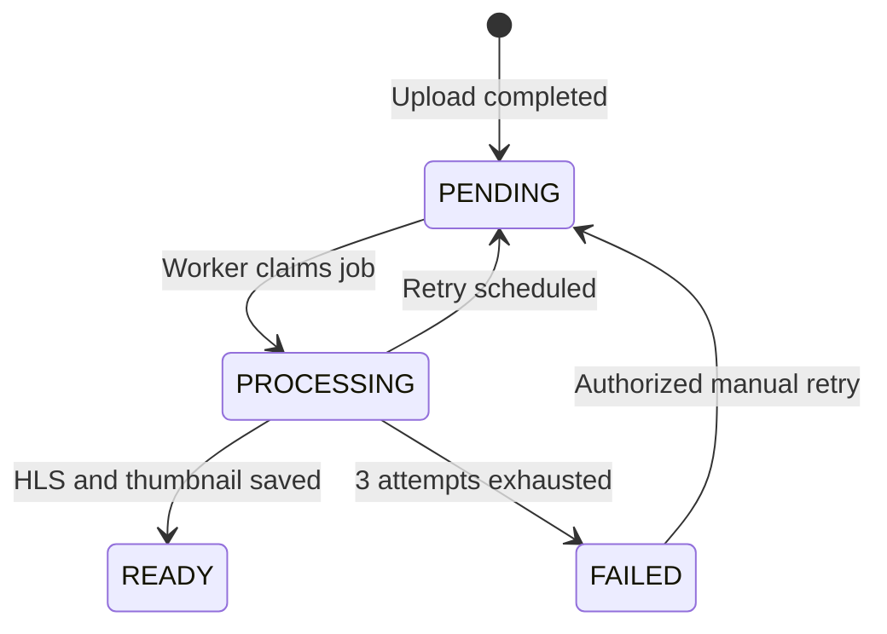

# Database Schema — Simple Explanation

PostgreSQL is the **source of truth** for users, videos and upload sessions. Prisma defines tables in `packages/db/prisma/schema.prisma`.

## Main tables

| Model           | What it stores                                                                           |
| --------------- | ---------------------------------------------------------------------------------------- |
| `User`          | Login, email, name and role (`USER`, `CREATOR`, `ADMIN`)                                 |
| `Video`         | Owner, status, original path, FFprobe metadata, thumbnail, counts and processing details |
| `UploadSession` | Resumable multipart session ID, storage upload ID, file info, owner, expiration          |
| `RefreshToken`  | Hashed refresh tokens and expiration for session management                              |

## Video lifecycle



## Main `Video` fields

- Media: `durationSeconds`, `width`, `height`, `videoCodec`, `fileSizeBytes`, `bitrate`, `audioChannels`.
- Processing: `status`, `processingJobId`, `processingAttempts`, `processingError`, `processingLeaseUntil`, `processingStartedAt`, `processedAt`.
- Usage: `viewCount`, `downloadCount`.
- Storage: `rawPath`, `thumbnailPath`.

## Useful commands

```bash
# Apply existing migrations automatically (Docker)
docker compose run --rm migrate

# Show most recent videos; credentials match the sample .env
docker compose exec postgres psql -U app -d app_db -c 'SELECT id,status,"viewCount","downloadCount" FROM "Video" ORDER BY "createdAt" DESC LIMIT 10;'
```

If you changed `.env`, replace `app` and `app_db` with your own values. Do not delete the database volume to fix a normal migration issue.
