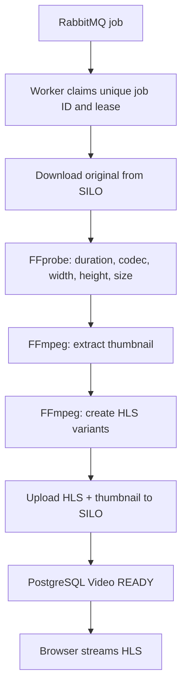

# Video Processing: FFprobe, FFmpeg, HLS

## 1. What happens after upload?



## 2. Adaptive resolutions

The worker offers target profiles **1080p, 720p, 480p**, but **never upscales** footage. It keeps aspect ratio; for ultrawide or portrait videos, actual output heights may be different. Hls.js selects the available rendition according to the network and player settings.

## 3. Files stored in object storage

```text
videos/
  raw/<creatorId>/<videoId>.<ext>     original, private
  thumbnails/<videoId>/thumbnail.jpg
  hls/<videoId>/master.m3u8
  hls/<videoId>/0/manifest.m3u8
  hls/<videoId>/0/segment_000.ts
  ...
```

The bucket remains **private**. Public READY video playback is provided through the API's HLS/thumbnail asset routes, not a public-read rule for all raw objects.

**No JWT is needed** for `GET /api/v1/video/stream/:videoId`, `GET /api/v1/video/hls/:videoId/*asset`, `GET /api/v1/video/thumbnail/:videoId` or `GET /api/v1/video/image/:videoId` when the video is `READY`. The source/original download stays protected by a short-lived, single-use ticket. See [OpenAPI authentication](../verification/openapi-authentication.md).

## 4. Processing progress

Worker writes temporary progress to Redis as `video:progress:{videoId}` and stores durable status and metadata in PostgreSQL. A progress key expires after **7 days**; the permanent READY/FAILED status does not.

## 5. Failure handling

Processing fails → schedule a retry (twice) → final failure goes to the DLQ. A processing job uses a database lease and unique job ID to reduce duplicate work and recover when a worker crashes.

Related: [Queues](queue-processing.md) and [Views / Downloads](analytics.md).
