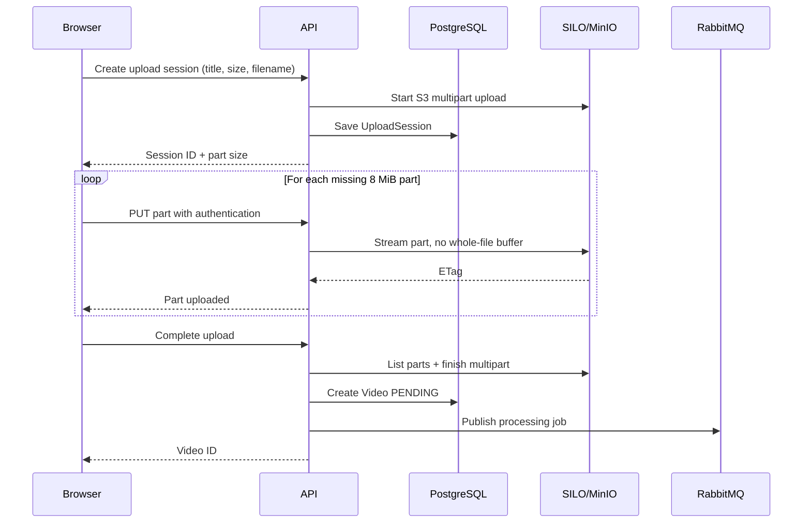
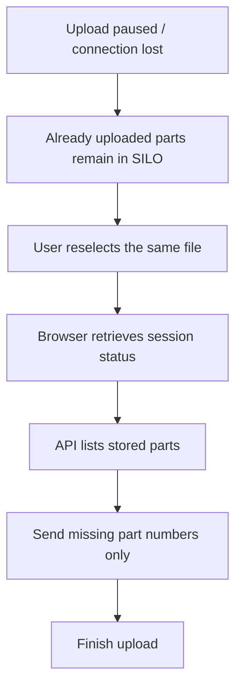

# Resumable Multipart Upload — Simple Guide

## 1. Why multipart upload?

Sending a 1 GB video as one request means a connection drop might force a complete restart. Instead, this project sends small pieces and can resume missing parts.

## 2. How it works

## 3. Size and recovery rules

| Setting                 | Current behavior                                                                           |
| ----------------------- | ------------------------------------------------------------------------------------------ |
| Chunk size              | **8 MiB** except the final smaller part                                                    |
| Maximum file size       | **2,147,483,647 bytes** (just under 2 GiB)                                                 |
| Upload session lifetime | **24 hours**                                                                               |
| Part retry              | Up to **3 attempts** per part                                                              |
| Storage location        | Unfinished pieces stay inside S3 multipart state; only completion creates the final object |
| Session persistence     | PostgreSQL UploadSession; browser keeps session ID in **localStorage**                     |
| Matching file           | Browser fingerprint uses filename, size, modification time and a hash of first/last MiB    |

## 4. Pause and resume

**Important distinctions:**

- Upload resume = continue sending missing file parts.
- Processing resume/retry = restart/recover FFmpeg processing from the **original video**, not from a partially encoded HLS segment.
- The existing legacy `/video/upload` endpoint still exists; the new web uploader uses `/video/upload-sessions`.

## 5. HTTP endpoints

All routes below are prefixed with `/api/v1/video`, and all require authentication.

| Method | Route                                           | Purpose            |
| ------ | ----------------------------------------------- | ------------------ |
| POST   | `/upload-sessions`                              | Start an upload    |
| GET    | `/upload-sessions/:sessionId`                   | See uploaded parts |
| PUT    | `/upload-sessions/:sessionId/parts/:partNumber` | Send a part        |
| POST   | `/upload-sessions/:sessionId/complete`          | Finalize           |
| DELETE | `/upload-sessions/:sessionId`                   | Cancel             |

## 6. Verify manually

1. Upload a video larger than 8 MiB.
2. Pause halfway through; resume and verify progress continues.
3. Refresh, choose the exact same file again, and verify already uploaded parts are skipped.
4. Complete upload; observe video status move from `PENDING` to `READY` after worker finishes.

Related code: `apps/web/src/features/creator/api/multipart.api.ts`, `apps/api/src/services/multipart-upload.service.ts`.
