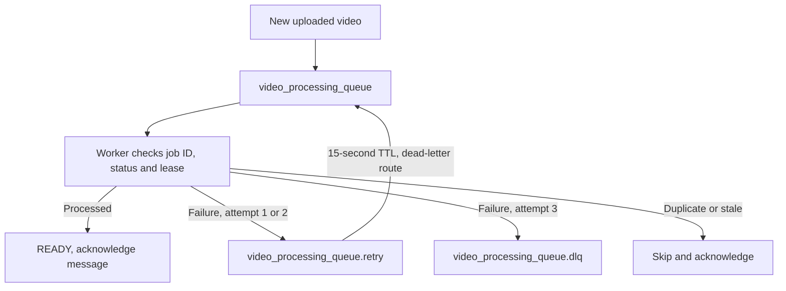

# RabbitMQ — Main, Retry and Dead-Letter Queues

## 1. The three queues

| Name                           | Why it exists                               | Who uses it?                                             |
| ------------------------------ | ------------------------------------------- | -------------------------------------------------------- |
| `video_processing_queue`       | Process new video jobs                      | API publishes; worker consumes                           |
| `video_processing_queue.retry` | Delay retriable failures by 15 seconds      | Worker publishes; RabbitMQ returns message to main queue |
| `video_processing_queue.dlq`   | Keep permanently failed jobs for inspection | Worker publishes after final failure                     |

## 2. Diagram



## 3. What happens on failure?

1. Worker attempts video processing (**attempt 1**).
2. If it fails, worker records the error and publishes **attempt 2** to the retry queue.
3. RabbitMQ holds it for **15 seconds**, then routes it back to the main queue.
4. A second failure schedules **attempt 3**.
5. If attempt 3 fails, worker publishes a message to the DLQ and marks the video **FAILED**.

**Important:** This implementation explicitly publishes final failures to the dead-letter exchange. The main queue is not configured to dead-letter every rejected message automatically.

## 4. Reliability and scaling

- Messages and queues are durable; publish confirmation is used.
- `prefetch(1)` means each worker consumes **at most one unacknowledged job at a time**.
- Multiple replicas consume from the same main queue.
- Processing uses a job ID and database lease to skip stale/duplicate work.
- A worker reconnects after the broker disconnects.
- **Manual retry** is an authorized action that creates a new processing attempt/job; failed DLQ messages are not automatically replayed by the UI.

## 5. Verify with commands

```bash
docker compose exec rabbitmq rabbitmqctl list_queues name messages_ready messages_unacknowledged consumers

docker compose up -d --scale worker=2 worker

docker compose logs --tail=100 worker
```

Two active workers should usually give **2 consumers** on the main queue. An empty DLQ is normal when no permanent failures have occurred. `messages_unacknowledged` can be nonzero while FFmpeg is running.

## 6. Related code

- `apps/worker/src/lib/rabbitmq.ts`
- `apps/worker/src/index.ts`
- `apps/api/src/lib/rabbitmq.ts`

Next: [Complete pipeline](../MEDIA_PIPELINE.md).
