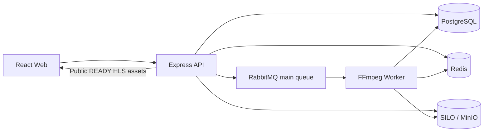

# System Architecture Overview

## 1. What each service does

| Service        | Technology              | Responsibility                                            |
| -------------- | ----------------------- | --------------------------------------------------------- |
| `web`          | React, Vite, Hls.js     | Uploads, gallery, player, admin dashboard                 |
| `api`          | Express, TypeScript     | Auth, upload sessions, videos, analytics, readiness       |
| `worker`       | Node.js, FFmpeg/FFprobe | Extract metadata, thumbnail and HLS                       |
| `postgres`     | PostgreSQL, Prisma      | Users, videos, sessions, processing state, counts         |
| `redis`        | Redis                   | Processing progress, view deduplication, download tickets |
| `rabbitmq`     | RabbitMQ                | Main, retry and dead-letter queues                        |
| `minio`        | S3-compatible SILO      | Original videos, HLS playlists/segments, thumbnails       |
| `migrate`      | Prisma                  | Applies existing database migrations, then exits 0        |
| `adminer`      | Adminer                 | Optional database UI                                      |
| `redisinsight` | Redis Insight           | Optional Redis UI                                         |

## 2. Architecture diagram

## 3. Why asynchronous processing?

The API accepts and completes a large upload **without waiting for FFmpeg**. The worker takes a queue message later, transcodes the video, and updates the database. The frontend displays progress while processing runs.

## 4. Read next

- [Complete flow](../MEDIA_PIPELINE.md)
- [Queue processing](queue-processing.md)
- [Multipart uploads](multipart-upload.md)
- [HLS processing](media-processing.md)
