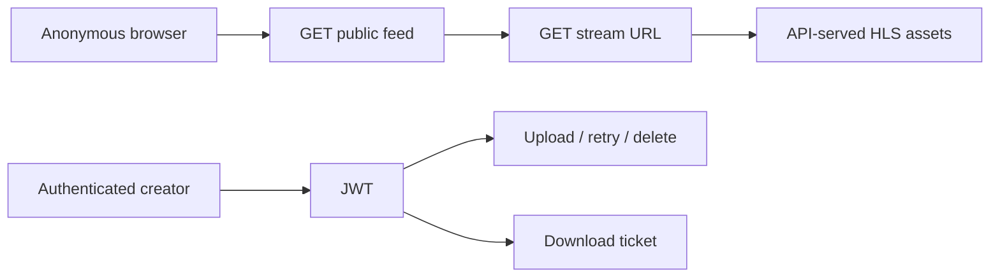

# API Service (`apps/api`)

**Purpose:** video uploads, authentication, public READY playback, analytics and service readiness. Implemented with Express + TypeScript + Prisma.

## 1. Main endpoints (prefix `/api/v1`)

| HTTP   | Path                                                  | Access              | Purpose                                        |
| ------ | ----------------------------------------------------- | ------------------- | ---------------------------------------------- |
| GET    | `/health`                                             | Public              | Day 4 readiness (DB, Redis, RabbitMQ, storage) |
| GET    | `/video/feed`                                         | Public              | Browse READY videos                            |
| GET    | `/video/stream/:videoId`                              | Public, READY only  | Returns URL of API-served HLS master playlist  |
| GET    | `/video/hls/:videoId/*asset`                          | Public, READY only  | HLS manifest and segments                      |
| GET    | `/video/thumbnail/:videoId`                           | Public, READY only  | Returns URL of API-served thumbnail            |
| GET    | `/video/image/:videoId`                               | Public, READY only  | Thumbnail image bytes                          |
| POST   | `/video/:videoId/view`                                | Public              | Record play event (Redis deduplication)        |
| POST   | `/video/upload`                                       | JWT                 | Legacy single-video upload                     |
| POST   | `/video/upload-sessions`                              | JWT                 | Start multipart upload                         |
| GET    | `/video/upload-sessions/:sessionId`                   | JWT                 | Inspect parts/status                           |
| PUT    | `/video/upload-sessions/:sessionId/parts/:partNumber` | JWT                 | Upload a part through API                      |
| POST   | `/video/upload-sessions/:sessionId/complete`          | JWT                 | Finish original upload + queue processing      |
| DELETE | `/video/upload-sessions/:sessionId`                   | JWT                 | Cancel upload                                  |
| GET    | `/video/creator`                                      | JWT                 | Creator video library                          |
| POST   | `/video/retry/:videoId`                               | JWT + authorization | Retry failed processing                        |
| DELETE | `/video/:videoId`                                     | JWT + ownership     | Delete video                                   |
| POST   | `/video/:videoId/download-ticket`                     | Owner/admin JWT     | Issue 60-second one-use ticket                 |
| GET    | `/video/:videoId/download?ticket=...`                 | Valid ticket        | Download private original via API              |
| GET    | `/admin/metrics`                                      | Admin JWT           | Dashboard statistics                           |

The authoritative endpoint definitions are in `apps/api/src/routes/`. A public HLS URL is **not** a public SILO bucket URL. Raw/original media stays private.

## 2. Public playback vs login



The older Swagger annotations for `stream` and `thumbnail` were outdated and showed `bearerAuth`. The optional `OPENAPI_PUBLIC_PLAYBACK.patch` in this package fixes those **documentation annotations** only. Read [OpenAPI Authentication](../verification/openapi-authentication.md).

## 3. Day 4 health check

```powershell
curl.exe -i "http://localhost:3000/api/v1/health"
```

- HTTP **200**: `{"status":"ok"}`.
- HTTP **503**: `{"status":"unavailable"}`.
- Response does **not** reveal internal credentials or hostnames.

## 4. Development / tests

```bash
corepack pnpm run dev:api
corepack pnpm --filter api build
corepack pnpm --filter api exec vitest run src/routes/health.routes.test.ts
```

Also see [Troubleshooting](../verification/troubleshooting.md).
